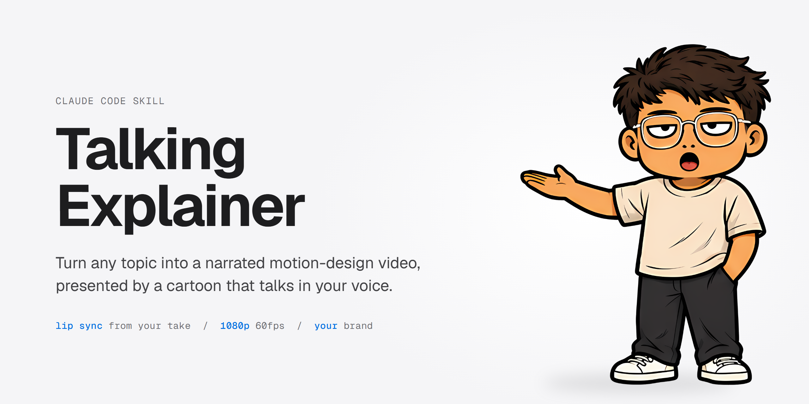
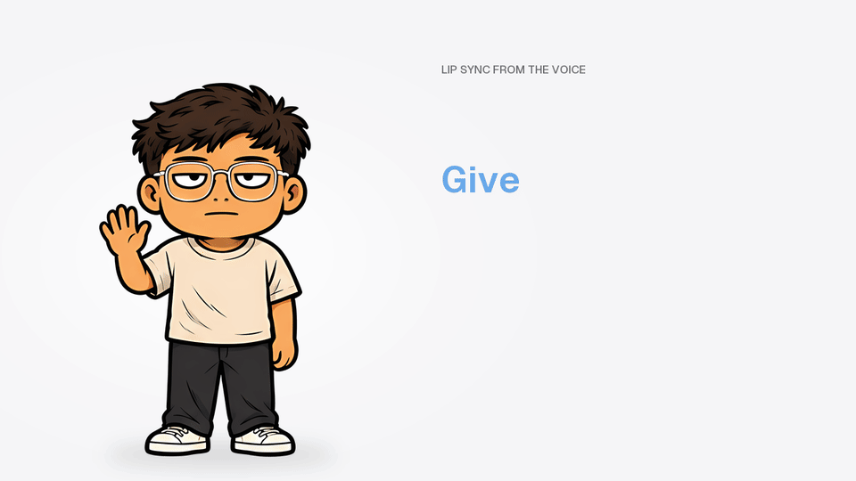
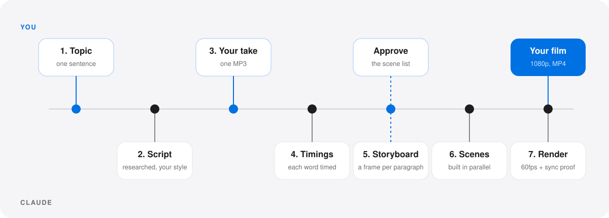
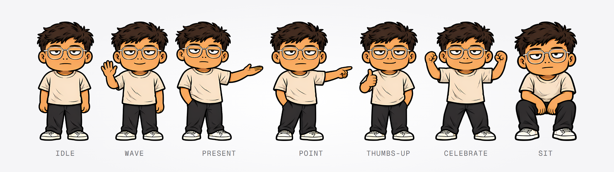

<p align="center">
  
</p>

# Talking Explainer

A Claude Code skill that turns a topic into a narrated motion-design explainer. A cartoon presenter really talks:
its mouth follows your voice, it changes pose on cue words, and it blinks. Short text and clean scenes animate in
time with every word you say, and your brand opens, sits in the corner of, and closes every film.

1920x1080 at 60fps, with a 9:16 cut for TikTok, Reels and Shorts when you ask for one.

Created by Kenneth Villar.

**[Install](#install)** &nbsp;·&nbsp; **[Your first film](#your-first-film)** &nbsp;·&nbsp;
**[How a film gets made](#how-a-film-gets-made)** &nbsp;·&nbsp; **[Your own presenter](#your-own-presenter)** &nbsp;·&nbsp;
**[Troubleshooting](#troubleshooting)**

---

## See it talk

<p align="center">
  
</p>

This GIF was made from the skill's own presenter art. The mouth shapes come from the same rules the film engine
runs on your recording (here, a computer voice reading one line). He waves on "Give", presents on "your", points on
"I" and gives a thumbs-up on "words", and every word appears on screen as it is said.

## What you get

- **A script in your voice.** Claude researches the topic, then writes a hook-first script in the way you talk.
  You can ask for any language.
- **A presenter that talks.** Six mouth shapes per pose, picked frame by frame from your take. Poses change on the words
  you choose. Blinks are added automatically.
- **Motion that lands on the word.** Your take is transcribed to word timings, and every entrance, camera push and
  highlight is keyed to the word that triggers it.
- **Your brand.** Your logo or wordmark opens the film, sits in the corner and closes it on your call to action.
- **Proof before you post.** The finished render is transcribed again and checked against the script timings, so you
  know the picture lands on the words.
- **Optional extras.** A portrait cut for short-form video, your own character as the presenter, and a music bed
  you have the rights to.

## What you need

| Need | Details |
|---|---|
| **Claude Code** | Any paid Claude plan. A film uses several parallel agents, so expect a long session (1-3 hours). |
| **A voice** | An [ElevenLabs](https://elevenlabs.io) voice clone (Starter plan or up), or a decent mic in a quiet room to read the script in one take. |
| **A computer** | Windows 10/11 or macOS, about 5 GB free disk. A dedicated GPU makes the final render much faster. |
| **Tools** | Node.js 20+, Python 3.10+ (3.12 recommended), ffmpeg. The setup check tells you exactly what is missing. |
| **Optional** | Your logo (PNG or SVG), a music track you own the rights to, a reference picture of your own character. |

## Install

**1. Install the tools.** Skip anything you already have.

Windows (PowerShell):

```powershell
winget install OpenJS.NodeJS.LTS Python.Python.3.12 Gyan.FFmpeg
py -3.12 -m pip install numpy pillow scipy faster-whisper
```

macOS (Terminal, needs [Homebrew](https://brew.sh)):

```bash
brew install node python@3.12 ffmpeg
python3.12 -m pip install numpy pillow scipy faster-whisper
```

Then the video engine's helper skills (both systems):

```bash
npx hyperframes skills update general-video hyperframes-animation media-use
```

**2. Get the skill.** Either:

- download `talking-explainer-skill.zip` from the [Releases](../../releases/latest) page and unzip it, or
- clone this repository: `git clone` it, then `cd` into the folder.

**3. Install it.** Open a terminal in the folder that has `install.mjs` and run:

```bash
node install.mjs
```

This copies three skills into `~/.claude/skills/`:

| Skill | What it is |
|---|---|
| `talking-explainer` | The one you talk to. It runs the whole film. |
| `explainer-kit` | Its tools: setup check, your profile, transcription, audio, lip sync, sync check. |
| `spatial-film` | The film engine: scenes, camera, presenter overlay, render. |

Then it checks your machine. Every line should say `OK`; anything marked `MISSING` comes with the command that fixes
it. Restart Claude Code once it is done.

Options: `--dest <folder>` installs somewhere other than `~/.claude/skills/`; `--force` replaces folders with the same
names that this installer did not create.

## Your first film

In Claude Code, in any folder, say:

> make a talking explainer about how email marketing works

### The first time, Claude sets you up (once)

1. **Missing tools** - the setup check lists them with install commands. Claude never installs system tools without
   asking.
2. **Your brand**, in one message: brand name, logo (optional; without one you get a text wordmark), text colour and
   accent colour, an opener word ("explains"), a call to action ("Follow for more"), the narration language and where
   films are saved.
3. **Your voiceover route** - an ElevenLabs voice clone, or recording yourself. You need one of the two.
4. **Your speaking style** - answer five quick questions, or give Claude the transcript of a 5+ minute unscripted
   recording of you talking and it measures your style from that.
5. **Your opener and closer lines**, word for word, with your first name.
6. **Your presenter** - the bundled demo, or your own character (see below).
7. **Music** (optional) - a track you own, the HeyGen catalog (`npx hyperframes auth login` once), or none.

All of it is saved to `~/.talking-explainer/profile/` and every film after that uses it.

### Every film, Claude asks you for

1. **The topic.**
2. **One MP3.** Claude gives you the script as plain text you can paste into ElevenLabs or read aloud, then waits for
   your recording.
3. **A yes on the storyboard** - the list of scenes, one per paragraph, before anything is built.
4. **A privacy check**, only when the film shows your own app or setup: a list of what will appear on screen, for you
   to approve first.

When it is done you get the MP4 and the credit line for your video description.

## How a film gets made

<p align="center">
  
</p>

1. **Script** - researched facts, a hook-first opener, one everyday analogy, about twelve short paragraphs.
2. **Your take** - one recording of the whole script. The visuals are built around your timing, never the other way
   round.
3. **Timings** - faster-whisper turns the take into word-by-word times. These are the cue sheet for everything else.
4. **Storyboard** - one frame per paragraph, each with a camera push and an emphasis beat on a chosen word.
5. **Scenes** - parallel AI workers build the scenes against one shared plan. Claude reviews each one from contact
   sheets and sends fixes back to the same worker.
6. **Presenter, audio, brand** - poses and lip sync from your take, the voice loudness-mastered with music ducked under
   it, your logo in the corner.
7. **Render and proof** - a 60fps render, a seam check between every scene, then the sync check on the rendered file.

## Your own presenter

<p align="center">
  
</p>

The demo presenter has seven talking poses (above), six mouth shapes for each, and blinks. To use your own
character, say:

> make my own talking character

Claude gives you three image prompts to run in an image tool with a reference picture of your character: one sheet
of poses, one of faces and one of effects. It cuts the results into sprites, fits the blinks and the six mouth
shapes, and shows you review sheets to approve before any film uses them.

## More you can ask for

| Say | What happens |
|---|---|
| "make a portrait version for TikTok" | A 1080x1920 cut of a finished film in a new folder. The 16:9 film is left untouched. |
| "I re-recorded the take, use the new one" | The film is re-timed to your new take, not rebuilt. |
| "show my explainer profile" | Prints your saved brand, voice and presenter settings. |
| "make my own talking character" | The custom presenter flow above. |

## Where things live

| Path | What |
|---|---|
| `~/.claude/skills/talking-explainer`, `explainer-kit`, `spatial-film` | The three skills. |
| `~/.talking-explainer/profile/` | Your brand, logo, voice notes, presenter and music. Kept when you update. |
| `~/.talking-explainer/config.json` | The Python command the setup check found. |
| The films folder you chose | One folder per film: scenes, audio, renders. |

## Updating

Get the new version (a new release zip, or `git pull`) and run `node install.mjs` again. Your profile is kept.

To uninstall, delete the three skill folders from `~/.claude/skills/` and the `~/.talking-explainer/` folder.

## Troubleshooting

| What you see | Fix |
|---|---|
| A script says "run setup-check first" | Run `node ~/.claude/skills/explainer-kit/scripts/setup-check.mjs` and install what it lists as `MISSING`. |
| `install.mjs` says a folder "already exists and was not installed by this script" | You have another skill with the same name. Move it aside, or run `node install.mjs --force` to replace it. |
| Claude does not react to "make a talking explainer" | Restart Claude Code after installing so it loads the new skills. |
| The voice clips or sounds too quiet | Let the skill master the audio. Never add plain gain to the take. |
| The render is very slow | No GPU was found, or another app is using it. Close other GPU apps, or let it run. |
| Your own character's mouth looks off | Go back through the mouth review sheet with Claude and refit before using it in a film. |

## Credits

- Icons in the films: Solar by 480 Design (CC BY 4.0). Put "Icons: Solar by 480 Design (CC BY 4.0)" in your video
  description; Claude reminds you at the end of every film.
- Fonts: Geist, Montserrat, Poppins (SIL Open Font License 1.1).
- Video engine: [HyperFrames](https://www.npmjs.com/package/hyperframes).
- Transcription: [faster-whisper](https://github.com/SYSTRAN/faster-whisper).

## License

MIT, with exceptions for the demo presenter artwork and the bundled fonts and icons. See [LICENSE](LICENSE).
